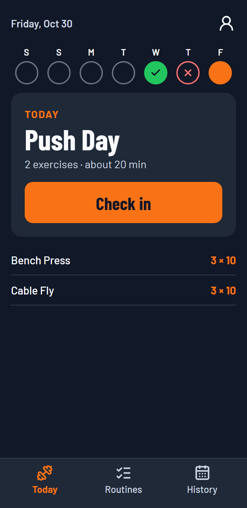
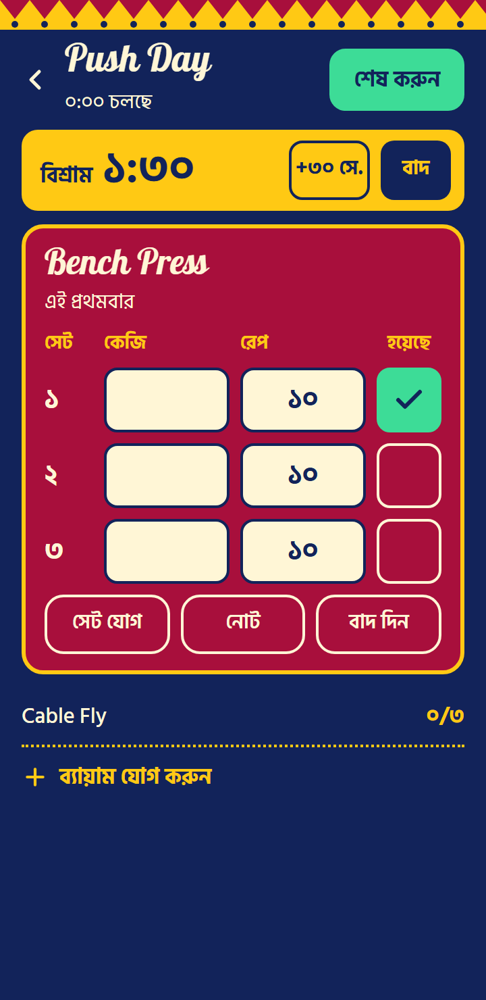
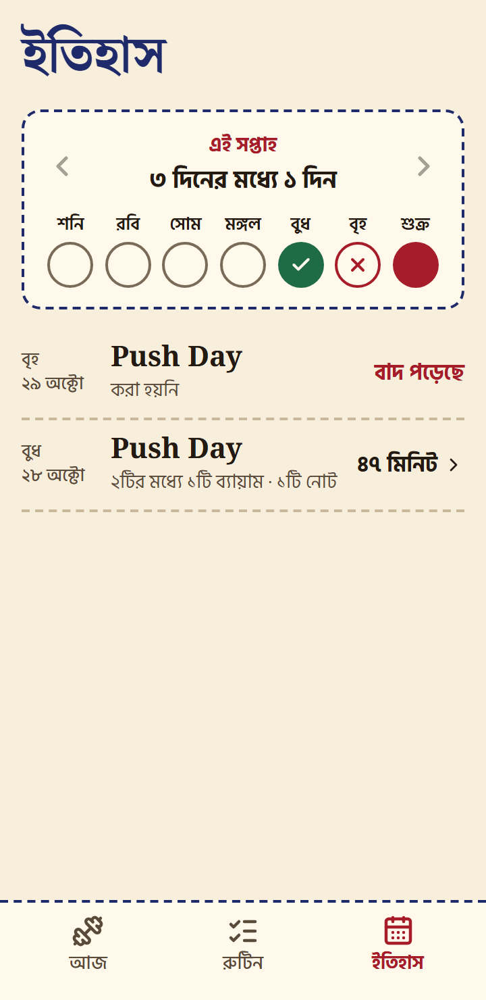
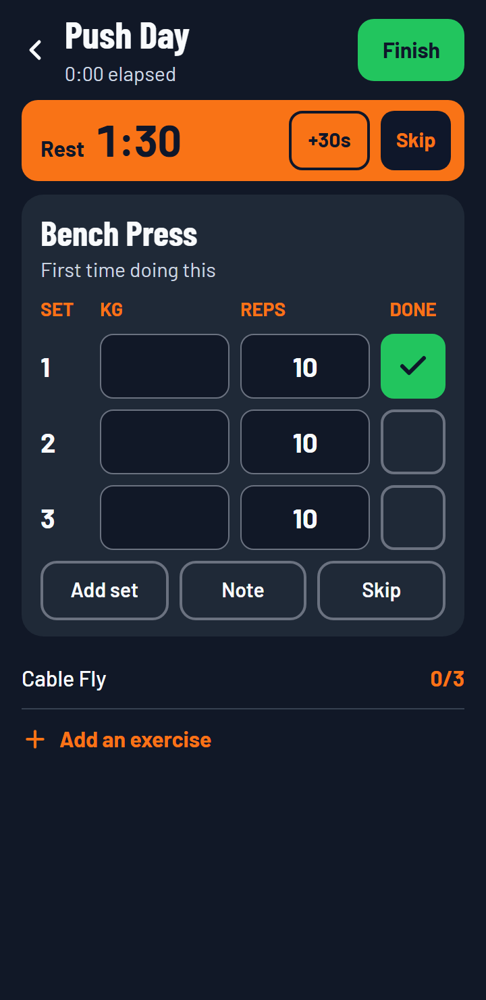
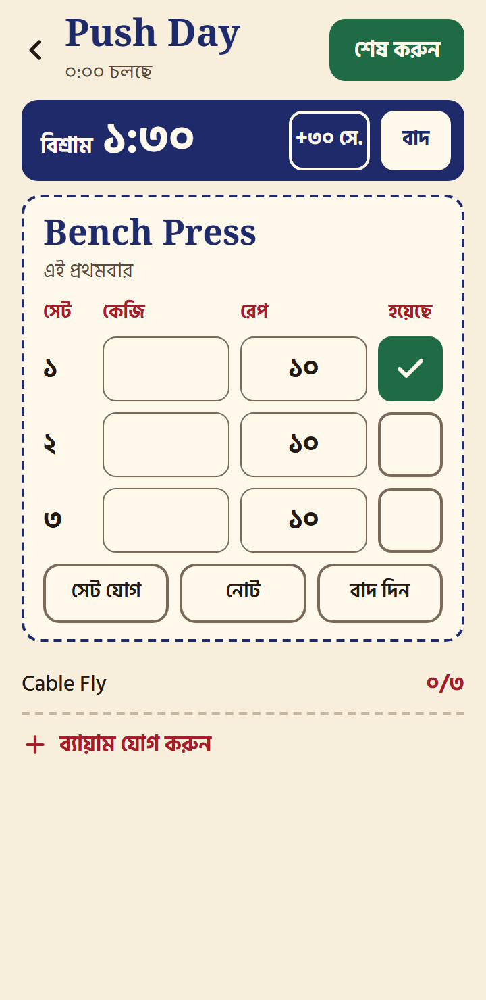
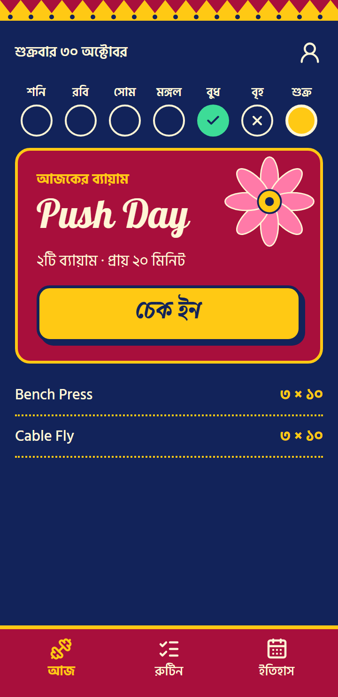
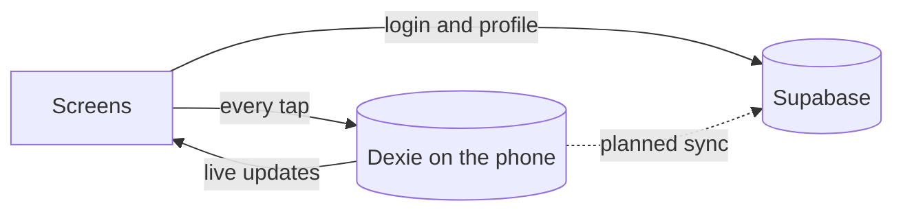
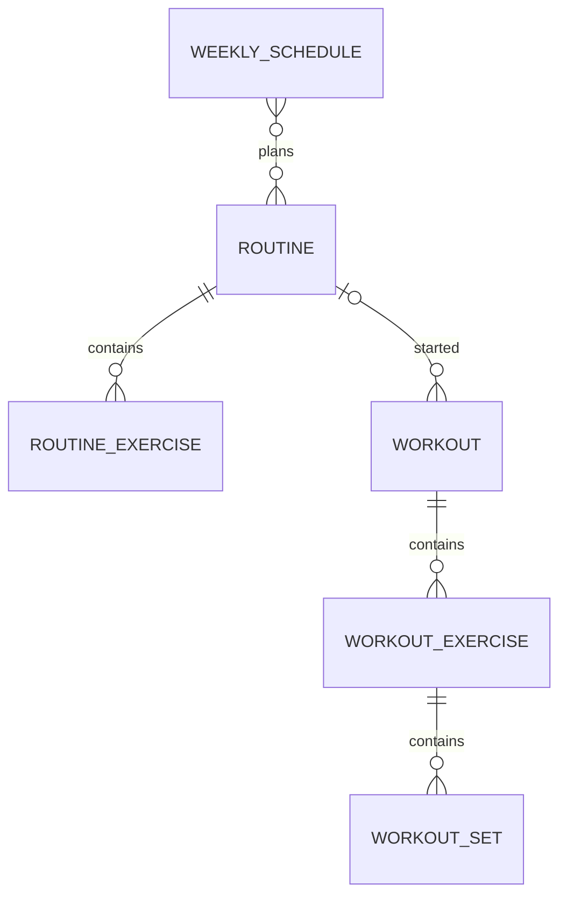

<div align="center">

# Gym Kori · জিম করি

**The workout tracker that feels at home in Bangladesh.**

Plan your week, check in at the gym, and log every set in seconds, in English or Bangla, even on a weak signal.


</div>

<p align="center">
  
  
  
</p>

## Why Gym Kori

Logging a workout has to be faster than resting between sets. Gym Kori opens on today's plan, fills in your numbers from last time, and confirms each set with one tap.

- **Fast at the gym:** sets are pre-filled, so most only need a single tap.
- **Built for real gyms:** everything saves to your phone first, so a basement gym with no signal doesn't lose your workout.
- **Made for Bangladesh:** full Bangla with Bangla numbers, a week that starts on Saturday, and themes drawn from local art.
- **Honest attendance:** see which days you trained, rested or missed, judged by the plan you had at the time.

## Status

Gym Kori is in active development and hasn't launched yet. V1 currently runs locally. Accounts and profiles use Supabase, while workouts stay on the device until sync is built. See the [roadmap](#roadmap).

## Features

### Available now

| Area | What you can do |
|---|---|
| **Today** | See the day's plan and the week at a glance, then check in with one tap |
| **Workout logging** | Tick sets, edit weight and reps, add sets, write notes, skip exercises, or add extras |
| **Last session** | See your previous numbers, with weights pre-filled from last time |
| **Rest timer** | Starts when you tick a set, keeps correct time across app switches, and alerts while the app is open |
| **Routines** | Build routines from 65 built-in exercises or your own, with sets and reps for each |
| **Weekly schedule** | Give each weekday a routine or make it a rest day |
| **History** | Review weekly attendance, missed days, and the full details of past workouts |
| **Recovery** | Reopen the app to return to a running workout, and get asked to check the duration if you forgot to finish |
| **Accounts** | Sign up, log in, reset your password, edit your name, log out, or delete your account |
| **Personalization** | Choose English or Bangla, one of three themes, and kg or lb, saved to your profile so they follow you |

### Three themes

<table>
  <tr>
    <th>Modern</th>
    <th>Nakshi Kantha</th>
    <th>Rickshaw Art</th>
  </tr>
  <tr>
    <td></td>
    <td></td>
    <td></td>
  </tr>
  <tr>
    <td>Clean, dark and minimal</td>
    <td>Hand-stitched lines on cream cloth</td>
    <td>The bold painted colors of Dhaka's rickshaws</td>
  </tr>
</table>

## Roadmap

| Stage | Includes | Status |
|---|---|---|
| **Foundation** | Themes, languages, app shell | Done |
| **Planning** | Exercises, routines, weekly schedule | Done |
| **Workout session** | Logging, rest timer, finish screen | Done |
| **History** | Attendance and workout details | Done |
| **Accounts** | Email and password login, profile, delete account | Done |
| **Sync and offline** | Sync across devices, opening with no signal | Next |
| **Launch** | Hosting and checks on real phones | Planned |
| **V2: Progress** | Analytics and charts, personal records, body measurements, streaks, Google sign-in | Later |
| **V3: Guidance** | Ready-made programs, exercise videos, suggestions for when to increase weight | Later |
| **V4: Extras** | Native app, social features, wearable sync, nutrition, AI coaching | Later |

## Tech stack

| Layer | Technology |
|---|---|
| App | [React](https://react.dev) and [TypeScript](https://www.typescriptlang.org), built with [Vite](https://vite.dev) |
| Styling | [Tailwind CSS](https://tailwindcss.com) with theme variables |
| Translations | [i18next](https://www.i18next.com) |
| On-device storage | [Dexie](https://dexie.org) (IndexedDB) |
| Tests | [Vitest](https://vitest.dev) and [Playwright](https://playwright.dev) |
| Linting | [Biome](https://biomejs.dev) |
| Accounts and database | [Supabase](https://supabase.com) |
| Hosting (planned) | [Vercel](https://vercel.com) |

## Getting started

You'll need [Node.js](https://nodejs.org) 24 or newer, the version the project is developed on.

```bash
npm install
cp .env.example .env.local
```

Add your Supabase project URL and publishable key to `.env.local`, then run each file in `supabase/migrations/` in the Supabase SQL editor, in order. Never put a secret or `service_role` key in this file.

```bash
npm run dev
```

Then open <http://localhost:5173>.

### Try it on your phone

Connect your phone to the same Wi-Fi as your computer, then run:

```bash
npm run phone
```

Open the **Network** address it prints. Browsers limit some features on plain `http://` addresses, so the screen won't stay awake during a workout in this mode.

## Scripts

| Command | What it does |
|---|---|
| `npm run dev` | Starts the app locally |
| `npm run phone` | Starts the app so devices on your network can open it |
| `npm run build` | Type checks and creates a production build |
| `npm run preview` | Serves the production build locally |
| `npm run typecheck` | Checks types |
| `npm run lint` | Runs the linter |
| `npm test` | Runs the unit tests |
| `npm run test:e2e` | Runs the browser tests |
| `npm run check` | Runs types, lint, unit tests and browser tests |
| `npm run verify:supabase` | Checks the real Supabase project's data protection, using temporary accounts |

The browser tests use a fake Supabase, so they never touch a real project. They need a one-time setup:

```bash
npx playwright install chromium
```

## How it works

Every action saves to the device immediately and never waits for the network. Screens read from the on-device database, so they update as soon as anything changes.



These rules keep the data trustworthy:

- **Weights are stored in kg as plain numbers.** Bangla digits and lb are only for entry and display.
- **Changing a schedule never rewrites history.** Each change starts a new version from that date, so past attendance is judged by the plan at the time.
- **Workouts keep their own copy of what happened.** Editing or deleting a routine leaves past workouts alone.
- **Deletes are recorded, not erased.** Rows keep a delete time so the change can sync to other devices later.
- **A workout belongs to the day it started**, even if it runs past midnight.
- **Each account has its own data on the device**, so people sharing a phone can't see each other's workouts, and logging out loses nothing.
- **The publishable key is safe in the app.** Row-level security in Postgres is what protects each person's data.

### Data model



## Project structure

```
src/
├── auth/          Login, session and profile sync
├── components/    Shared interface pieces
├── data/          Database, business rules and data hooks
├── i18n/          English and Bangla text
├── lib/           Small helpers for dates, digits, units and IDs
├── preferences/   Language, theme and unit settings
├── screens/       One file per screen
├── styles/        Theme variables and shared styles
├── utils/         The Supabase client
└── workout/       Rest timer and keep-awake behavior
e2e/               Browser tests
docs/              Build plan and screenshots
scripts/           Checks against the real Supabase project
supabase/          Database migrations
```

## Development guide

- **Text:** never type interface text into a screen. Add it to `src/i18n/en.ts` and `src/i18n/bn.ts`. TypeScript reports any text missing from the Bangla file.
- **Styling:** never hard-code colors, fonts or corner sizes in a screen. Use the theme variables in `src/styles/index.css`.
- **Data:** change the Dexie schema by adding a new version in `src/data/db.ts`, never by editing an old one.
- **Testing:** every screen must work in all 6 theme and language combinations, including on a small phone with no sideways scrolling.

Before opening a pull request, run:

```bash
npm run check
```

The full product plan is in [docs/v1-build-plan.md](docs/v1-build-plan.md).

## License

Copyright © 2026 Gym Kori. All rights reserved.
